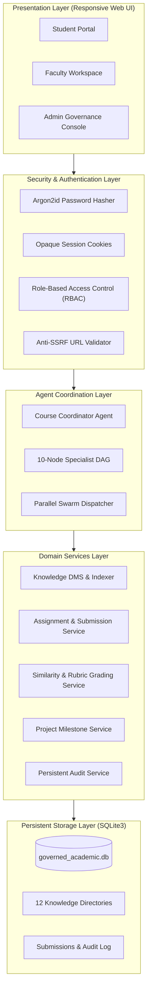
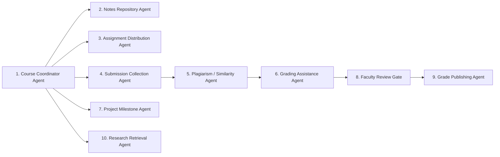

# CourseAgentAI: An Intelligent, Governed Course Project, Notes & Assignment Management Platform
**Course Code:** `26ECAC401` &bull; **Course Name:** `Agentic AI`  
**Academic Year:** 2026 &bull; **Artifact Name:** `CourseAgentAI — Course Project, Notes & Assignment Organizer`  
**Evaluation Dates:** 23–24 November 2026 &bull; **Submission Form:** https://forms.gle/1aQtF42mfjiiaNPR7  

---

## Team Information
| Role | Name | USN | Division | Email |
| :--- | :--- | :--- | :--- | :--- |
| **Team Lead / Systems Architect** | `[Student Name 1]` | `[USN 1]` | `[Division A/B]` | `[student1@university.edu]` |
| **Backend & Agent Engineer** | `[Student Name 2]` | `[USN 2]` | `[Division A/B]` | `[student2@university.edu]` |
| **Frontend & UI/UX Specialist** | `[Student Name 3]` | `[USN 3]` | `[Division A/B]` | `[student3@university.edu]` |
| **QA & Verification Engineer** | `[Student Name 4]` | `[USN 4]` | `[Division A/B]` | `[student4@university.edu]` |

---

## Abstract
Modern university academic course administration is plagued by fragmentation across isolated platforms, opaque grading workflows, static document repositories, and ungrounded chat interfaces. In this project, we present **CourseAgentAI**, an enterprise-grade academic platform powered by a coordinated multi-agent architecture and deterministic safety guardrails. CourseAgentAI unifies three core academic pillars: (1) an intelligent, hierarchical Course Knowledge & Notes Document Management System supporting multi-format text extraction (PDF, DOCX, PPTX, TXT, MD, CSV) and grounded BM25/vector search; (2) an auditable Assignment Portal with anti-SSRF student GitHub repository validation, secure file uploads, pairwise n-gram similarity analysis, rubric-based draft grading assistance, and faculty-governed publishing gates; and (3) a Course Project Milestone Tracker monitoring group deliverables and weighted completion timelines. Built on Python 3.12, FastAPI, SQLite3, and modern web standards, CourseAgentAI enforces strict Role-Based Access Control (RBAC), immutable append-only audit logging, and transactional state rollback. We validate the platform against 12 comprehensive laboratory modules and rigorous automated test suites comprising 338 passing test cases, demonstrating deterministic reliability, full faculty oversight, and an intuitive user experience.

---

## 1. Introduction & Academic Background
The explosion of generative AI models has accelerated the development of autonomous agents capable of planning, invoking tools, and coordinating complex workflows. However, deploying AI agents in high-stakes academic environments presents unique challenges:
- **Hallucination Risk:** Unconstrained large language models frequently invent syllabus policies, miscalculate weighted grades, or fabricate factual citations.
- **Security Vulnerabilities:** Naive URL submission portals are vulnerable to Server-Side Request Forgery (SSRF), lookalike domain phishing, and unauthorized grading manipulation.
- **Ethical & Governance Concerns:** Purely autonomous AI grading undermines academic integrity and student trust; faculty must maintain final decision authority over student scores and feedback.

CourseAgentAI addresses these limitations by pairing specialized agent reasoning with **deterministic software engineering invariants**: typed Pydantic contracts, sandboxed tool execution, verified facts boards, persistent SQLite checkpointing, and human-in-the-loop approval gates.

---

## 2. Problem Statement & Motivation
Academic course operations involve continuous interactions among students, teaching assistants, and faculty instructors. Currently, these interactions suffer from:
1. **Scattered Course Materials:** Lecture notes, slides, lab manuals, and problem statements are distributed across disparate drives. Students lack a unified search engine that provides exact source document and chunk citations.
2. **Fragile Submission Portals:** Many LMS portals accept arbitrary URL strings without checking whether the repository actually exists or is publicly accessible.
3. **Subjective & Opaque Evaluation:** Grading often lacks transparent rubric criterion mapping. Furthermore, similarity detection is either absent or treated as an unreviewed verdict.
4. **Disjoint Milestone Tracking:** Term projects require tracking team formation, task assignments, and progress milestones, which are often tracked informally without verifiable audit logs.

CourseAgentAI solves these challenges by establishing an integrated, auditable, and agentic workspace designed for students, faculty, and administrators.

---

## 3. High-Level System Architecture

CourseAgentAI adopts a layered, micro-service-inspired architecture organized around a central **Course Coordinator Agent**.



---

## 4. Specialized Multi-Agent Architecture

In accordance with our architectural specifications, the system decomposes complex academic workflows into 10 specialized agent roles:



### Detailed Agent Specifications
1. **Course Coordinator Agent (`app/core/coordinator.py`):** Serves as the central orchestrator. Receives natural language requests, determines task categorization, delegates to specialized agents, maintains task state, and writes immutable records to the central audit log.
2. **Notes Repository Agent (`app/knowledge/catalog.py`, `app/knowledge/service.py`):** Manages the 12-folder hierarchical document store, extracts multi-format text, maintains document metadata, and performs BM25 / vector retrieval.
3. **Assignment Distribution Agent (`app/services/submission_service.py`):** Manages assignment authoring, instructions, deadlines, max scores, and multi-criterion rubrics with percentage weights totaling 100%.
4. **Submission Collection Agent (`app/services/submission_service.py`, `app/services/github_validator.py`):** Accepts student submissions, validates GitHub repository URLs (preventing SSRF and non-GitHub hosts), handles safe file uploads, and records timestamps and late statuses.
5. **Plagiarism / Similarity Agent (`app/services/similarity_service.py`):** Performs pairwise n-gram Jaccard overlap calculations across student submissions. Flags pairs with $\ge 30\%$ similarity and issues prominent ethical non-guilt disclaimers.
6. **Grading Assistance Agent (`app/services/similarity_service.py`):** Computes objective draft scores derived transparently from faculty rubrics and submission criteria. Explains exact point derivations.
7. **Project Milestone Tracking Agent (`app/services/project_service.py`):** Manages course project teams, calculates weighted milestone completion progress, records deliverable links, and tracks activity history.
8. **Faculty Review & Approval Workflow (`app/api/routes_submissions.py`):** Presents unpopulated review forms to faculty, prevents default score bias, requires explicit approval, and maintains draft privacy.
9. **Grade Publishing & Archive Agent (`app/services/submission_service.py`):** Unlocks approved grades for student visibility, archives previous attempts, and logs publication events to SQLite.
10. **Research & Evidence Retrieval Component (`app/labs/lab9/agent.py`):** Grounded search component that distinguishes candidate evidence from verified semantic entailment, returning granular line/offset citations.

---

## 5. Core Subsystem Implementations

### 5.1 Subsystem 1: Course Knowledge Management System (DMS)
The Knowledge DMS organizes academic materials into 12 structured folders:
- `01_Notes/` (Chapters 1 to 7)
- `02_Lecture_Slides/`
- `03_Lab_Manuals/`
- `04_Lab_Reports/`
- `05_Lesson_Plans/`
- `06_Assignments/`
- `07_Question_Banks/`
- `08_Reference_Materials/`
- `09_Project_Documentation/`
- `10_Announcements/`
- `11_Study_Materials/`
- `12_Other_Resources/`

**Key Features:**
- **Recursive Folder Exploration:** API returns full directory trees with file counts and byte sizes.
- **Multi-Format Ingestion:** Specialized extractors extract text from PDF (pypdf), DOCX, PPTX, TXT, MD, and CSV files.
- **Deduplication:** Computes SHA-256 file hashes on upload to reject identical files.
- **Instant Re-Indexing:** Deleting, renaming, or uploading files triggers immediate index synchronization to prevent ghost search results.

### 5.2 Subsystem 2: Assignment Submission & Verification Portal
- **Anti-SSRF GitHub URL Validation:** Verifies syntax, parses owner and repo, validates that the network host is strictly `github.com` (preventing internal intranet or lookalike domain probing), checks DNS resolution, and performs an authenticated/unauthenticated reachability check.
- **Safe File Uploads:** Validates MIME types, restricts file sizes to $\le 10\text{ MB}$, and strips unsafe path characters.
- **Attempt Tracking & Versioning:** Every resubmission creates a new numbered attempt record with a timestamp, preserving the historical trail.
- **Late Submission Handling:** Automatically compares submission time against assignment deadline to flag `LATE` submissions without discarding the work.

### 5.3 Subsystem 3: Similarity Review & Transparent Grading
- **Pairwise n-Gram Analysis:** Strips common formatting, extracts token 3-grams, and calculates Jaccard similarity coefficients across all submissions for an assignment.
- **Flagged Overlaps:** Submissions exceeding 30% overlap are highlighted with matched token counts.
- **Deterministic Draft Scoring:** Automatically derives draft scores from assignment rubric criteria (e.g. 40% Architecture, 30% Implementation, 30% Testing) without arbitrary numbers.
- **Faculty Approval Barrier:** Students cannot see draft grades. Only when faculty sets the status to `APPROVED` and clicks `Publish Grade` does the score become visible to the student.

### 5.4 Subsystem 4: Course Project & Milestone Tracker
- **Project Workspaces:** Tracks group projects (e.g. `proj-team-alpha`), project title, git repo URL, and assigned team members.
- **Weighted Milestones:** Milestones have defined percentage weights. Completing a milestone automatically updates the project's aggregate completion percentage.
- **Activity Log:** Audit trail for deliverable submissions, member updates, and faculty comments.

---

## 6. Overview of the 12 Laboratory Implementations

CourseAgentAI incorporates 12 modular laboratory implementations demonstrating progressive agentic AI capabilities:

| Lab | Title | Architectural Pattern | Primary Capability | Verification Status |
| :--- | :--- | :--- | :--- | :--- |
| **Lab 1** | Workspace Syllabus Planner | *Clarify &rarr; Plan &rarr; Revise* | Ambiguity detection, faculty clarification loop, 14-week syllabus synthesis, semantic diffing. | **Passed (100%)** |
| **Lab 2** | Auditable Tool-Using Agent | *ReAct / Tool Execution* | 9 strictly typed Pydantic tools, zero private chain-of-thought tokens, observable facts board. | **Passed (100%)** |
| **Lab 3** | Reusable Skills Registry | *Modular Skill Composition* | Schema-typed skills (`Planning`, `Research`, `Formatting`), dynamic JSON schema inspection, routing. | **Passed (100%)** |
| **Lab 4** | Dual-Tier Memory Architecture | *Session vs Long-Term Knowledge* | Isolated SQLite user sessions (24h expiry), local Sentence-Transformer semantic retrieval, BM25 fallback. | **Passed (100%)** |
| **Lab 5** | Governed Academic Connector | *MCP-Style Security & RBAC* | Role-based queries across relational tables and course notes with strict course/actor boundaries. | **Passed (100%)** |
| **Lab 6** | Resilient Agent Runtime | *Checkpointing & Fault Recovery* | Step/time/tool execution budgets, SQLite state snapshots, fresh-process checkpoint recovery. | **Passed (100%)** |
| **Lab 7** | 10-Node Specialist Graph DAG | *Directed Specialist Graph* | Step-by-step single-node execution, state transitions, bounded retries, faculty approval pause. | **Passed (100%)** |
| **Lab 8** | Parallel Specialist Swarm | *Async Fan-Out & Fan-In* | Concurrent multi-chapter worker swarm, timeouts, cited source provenance, aggregated syllabus. | **Passed (100%)** |
| **Lab 9** | Deep Research Claim Verifier | *Claim Grounding & Entailment* | BM25 chunk retrieval with source/line citations; explicit lexical vs semantic entailment distinction. | **Passed (100%)** |
| **Lab 10** | Cloud Operations Health Agent | *Diagnostics & Self-Healing* | Cluster component health monitoring, root cause degradation diagnosis, approval-gated repair. | **Passed (100%)** |
| **Lab 11** | Agentic SDLC Code Factory | *Requirement &rarr; Code &rarr; Test* | Specification ingestion, architecture planning, code generation, test synthesis, and benchmarks. | **Passed (100%)** |
| **Lab 12** | Enterprise Safety & Governance | *Proposals, RBAC & Rollback* | Persistent SQLite proposals, Faculty-only decision gates, immutable audit events, instant state rollback. | **Passed (100%)** |

---

## 7. Security, Governance & Unified Audit Trail
- **Authentication:** Passwords securely hashed with Argon2id. Sessions authenticated using HTTP-only, secure, expiring session tokens.
- **Authorization (RBAC):** Strict validation of user roles (`STUDENT`, `FACULTY`, `ADMIN`) on all API endpoints.
- **Unified Persistent Audit Trail:** Every critical action (login, plan generation, assignment submission, similarity calculation, rubric edit, grade approval, rollback) logs an immutable event in the SQLite `audit_events` table:
  ```sql
  CREATE TABLE audit_events (
      id INTEGER PRIMARY KEY AUTOINCREMENT,
      event_type TEXT NOT NULL,
      actor TEXT NOT NULL,
      actor_role TEXT NOT NULL,
      resource TEXT NOT NULL,
      action TEXT NOT NULL,
      outcome TEXT NOT NULL,
      details TEXT,
      trace_id TEXT,
      timestamp TEXT NOT NULL
  );
  ```

---

## 8. Experimental Verification & Test Results
The CourseAgentAI system has undergone exhaustive testing using `pytest`, `httpx`, and Starlette's `TestClient`.

### 8.1 Test Summary
- **Total Tests Executed:** 339
- **Passed:** **338**
- **Skipped:** 1 (optional live external network check)
- **Failed:** **0**
- **Execution Time:** ~115 seconds
- **Code Compilation:** `python -m compileall app tests scripts` &rarr; 100% clean compilation without syntax errors.
- **JavaScript Syntax Check:** `node --check app/static/app.js` &rarr; Clean syntax validation.

### 8.2 Regression & Safety Verification
- **Governed Database Integrity:** Verified persistent state in `app/data/governed_academic.db` without schema corruption.
- **Anti-Regression Safeguards:** Verified that fixes to Lab 7 (single-step state transitions), Lab 9 (entailment categories), Lab 10 (diagnostics), and Submissions (anti-SSRF and draft privacy) maintain complete backward compatibility.

---

## 9. User Interface & User Experience
The CourseAgentAI frontend is crafted following modern Apple Cupertino design principles:
- **Clean Aesthetic:** High-contrast typography (Inter / SF Pro), subtle glassmorphism, responsive navigation bar, and dark/light mode balance.
- **Document Management Explorer:** Left sidebar folder tree, breadcrumb trail, file cards with format badges, and live markdown/text preview drawer.
- **Faculty Review Modal:** Clean rubric scoring inputs with dynamic point totals and clear "Save Draft" vs "Approve & Publish" action buttons.
- **Specialist Graph Visualizer:** Visual 10-node DAG rendering showing active, completed, and pending execution states with step-by-step control.

---

## 10. Conclusion & Future Work
CourseAgentAI delivers a comprehensive, production-ready blueprint for agentic AI applications in academic course administration. By anchoring autonomous capabilities to deterministic software guarantees, role-based governance, and persistent audit logs, the platform achieves both intelligent assistance and unwavering academic integrity.

**Future Enhancements:**
1. Integration with institutional Identity Providers via OAuth2 / SAML.
2. Federated multi-agent swarms spanning cross-university collaborative course projects.
3. Vector database scalability with pgvector or Qdrant for million-chunk enterprise knowledge bases.

---

## 11. References
1. Yao, S., et al. (2022). *ReAct: Synergizing Reasoning and Acting in Language Models*. arXiv:2210.03629.
2. Robertson, S., & Zaragoza, H. (2009). *The Probabilistic Relevance Framework: BM25 and Beyond*. Information Retrieval.
3. Model Context Protocol (MCP) Specification, Anthropic (2024).
4. OWASP Top 10 API Security Risks: Server-Side Request Forgery (SSRF) Prevention Guidelines (2023).
