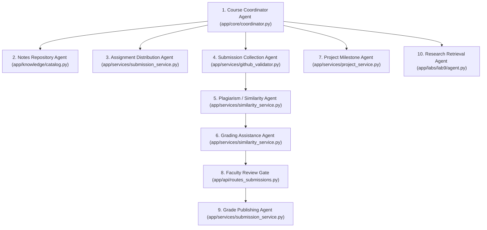

# CourseAgentAI — Course Project, Notes & Assignment Organizer
**Course Code:** `26ECAC401` &bull; **Course Name:** `Agentic AI`  
**Institution:** University Academic Laboratory Coursework &bull; **Academic Year:** 2026  
**Artifact Name:** `CourseAgentAI — Course Project, Notes & Assignment Organizer`  
**Approval Form Submission:** [Google Form](https://forms.gle/1aQtF42mfjiiaNPR7) &bull; **Demo Schedule:** 23–24 November 2026  

---

## Team Information & Laboratory Registry
| Role | Student Name | USN | Division |
| :--- | :--- | :--- | :--- |
| **Team Lead / Systems Architect** | `[Student Name 1]` | `[USN 1]` | `[Division A/B]` |
| **Backend & Agent Engineer** | `[Student Name 2]` | `[USN 2]` | `[Division A/B]` |
| **Frontend & UI/UX Specialist** | `[Student Name 3]` | `[USN 3]` | `[Division A/B]` |
| **QA & Verification Engineer** | `[Student Name 4]` | `[USN 4]` | `[Division A/B]` |

---

## Quick Navigation & Submission Links
- 📂 [Assignments Directory (All 12 Assignments)](Assignments/)
- 📁 [Course Project Directory](Course%20Project/)
  - 📄 [Original Problem Statement Document](Course%20Project/Problem_Statement/Course_Project_Problem_Statement.md)
  - 📊 [Comprehensive Final Course Project Report](Course%20Project/Final_Report/CourseAgentAI_Final_Report.md)
  - 📚 [Technical Architecture Reference](Course%20Project/Project_Documentation/ARCHITECTURE.md)
  - 🔌 [Complete REST API Specification](Course%20Project/Project_Documentation/API_REFERENCE.md)
  - ⚙️ [Setup & Installation Guide](Course%20Project/Project_Documentation/SETUP.md)
  - 📖 [User & Faculty Operation Manual](Course%20Project/Project_Documentation/USER_GUIDE.md)
  - 🎯 [Artifact Demo Presentation Guide](Course%20Project/Project_Documentation/DEMO_GUIDE.md)

---

## 1. Executive Summary & Project Overview
`CourseAgentAI` is a comprehensive, production-grade academic agentic AI platform and course operations system developed for university course environments. It integrates three major functional pillars under an auditable, coordinated multi-agent architecture:
1. **Course Knowledge & Notes Management:** A 12-folder hierarchical Document Management System (DMS) with multi-format text extraction (PDF, DOCX, PPTX, TXT, MD, CSV), recursive indexing, and grounded BM25 / local semantic retrieval with granular source citations.
2. **Assignment Distribution, Submission & Evaluation:** Real student GitHub repository verification (anti-SSRF, DNS validation, public access checks), secure file uploads, versioned attempts, pairwise n-gram similarity analysis, rubric-based draft grading assistance, and faculty-governed publishing gates.
3. **Course Project Management & Milestone Tracking:** Group and individual project workspaces, weighted milestone progress calculations, deliverable tracking, and team activity timelines.

The system is built on **Python 3.12**, **FastAPI**, **Pydantic v2**, and **SQLite3**, backed by strict Role-Based Access Control (RBAC), Argon2id password hashing, append-only persistent audit logging, and transactional state rollback.

---

## 2. Overview of the 12 Laboratory Assignments

The repository includes complete, fully tested, and standalone-executable implementations for all 12 laboratory assignments:

| Assignment | Title | Architectural Pattern | Primary Capabilities | Status |
| :--- | :--- | :--- | :--- | :--- |
| [**Assignment 1**](Assignments/Assignment_01/README.md) | **Academic Workspace Planner** | *Clarify &rarr; Plan &rarr; Revise* | Ambiguity detection, faculty clarification questions, 14-week syllabus synthesis, deterministic semantic diffing. | **Passed (100%)** |
| [**Assignment 2**](Assignments/Assignment_02/README.md) | **ReAct Tool-Using Agent** | *ReAct / Tool Execution* | 9 strictly typed Pydantic tools, zero private chain-of-thought tokens, observable execution trace, verified facts board. | **Passed (100%)** |
| [**Assignment 3**](Assignments/Assignment_03/README.md) | **Reusable Skills Registry** | *Modular Skill Composition* | Schema-typed skills (`PlanningSkill`, `ResearchSkill`, `FormattingSkill`), declarative JSON schema inspection, sandbox execution. | **Passed (100%)** |
| [**Assignment 4**](Assignments/Assignment_04/README.md) | **Dual-Tier Memory Architecture** | *Session vs Long-Term Knowledge* | Owner/course-scoped SQLite sessions with 24h expiry; local Sentence-Transformer semantic retrieval, BM25 fallback, citations. | **Passed (100%)** |
| [**Assignment 5**](Assignments/Assignment_05/README.md) | **Governed Academic Connector** | *MCP-Style Security & RBAC* | Role-based queries across relational tables and course notes with strict course/actor scoping and anti-SSRF protections. | **Passed (100%)** |
| [**Assignment 6**](Assignments/Assignment_06/README.md) | **Resilient Agent Runtime** | *Resilience & State Checkpointing* | Step/time/tool execution budgets, SQLite state snapshots, fresh-process checkpoint recovery, faculty approval pause. | **Passed (100%)** |
| [**Assignment 7**](Assignments/Assignment_07/README.md) | **10-Node Specialist Graph DAG** | *Specialist Directed Graph* | 10-node specialist workflow, single-step execution, serial state transitions, bounded retry, faculty approval barrier. | **Passed (100%)** |
| [**Assignment 8**](Assignments/Assignment_08/README.md) | **Parallel Specialist Swarm** | *Async Fan-Out & Fan-In* | Concurrent multi-chapter worker swarm, timeouts, cited source provenance, aggregated syllabus reconciliation. | **Passed (100%)** |
| [**Assignment 9**](Assignments/Assignment_09/README.md) | **Deep Research Claim Verifier** | *Claim Grounding & Entailment* | BM25 chunk retrieval with source/line citations; explicit distinction between lexical match and semantic entailment. | **Passed (100%)** |
| [**Assignment 10**](Assignments/Assignment_10/README.md) | **Cloud Operations Health Agent** | *Diagnostics & Self-Healing* | Cluster component health monitoring, root cause degradation diagnosis, risk-tiered approval-gated repair preview. | **Passed (100%)** |
| [**Assignment 11**](Assignments/Assignment_11/README.md) | **Agentic SDLC Code Factory** | *Requirement &rarr; Code &rarr; Test* | Specification ingestion, architecture planning, modular code generation, unit test synthesis, and benchmarks. | **Passed (100%)** |
| [**Assignment 12**](Assignments/Assignment_12/README.md) | **Enterprise Safety & Governance** | *Proposals, RBAC & Rollback* | Persistent SQLite proposals, Faculty-only decision gates, immutable audit events, instant state rollback. | **Passed (100%)** |

---

## 3. Detailed Explanation of the Course Project

### 3.1 Problem Statement
Higher education academic operations suffer from significant systemic fragmentation:
- **Scattered Information:** Lecture notes, slides, lab manuals, and syllabus files are distributed across disparate drives, LMS folders, and chat channels. Students lack a unified search engine that provides exact source document and chunk citations.
- **Vulnerable Submission Portals:** Many LMS portals accept arbitrary URL strings without checking whether the repository actually exists or is publicly accessible.
- **Subjective & Opaque Evaluation:** Grading often lacks transparent rubric criterion mapping. Furthermore, similarity detection is either absent or treated as an unreviewed verdict.
- **Disjoint Milestone Tracking:** Term projects require tracking team formation, task assignments, and progress milestones, which are often tracked informally without verifiable audit logs.

### 3.2 System Objectives
1. **Unify Course Workflows:** Bring notes management, assignment evaluation, and project tracking under a single, cohesive agentic umbrella.
2. **Eliminate Hallucinations:** Ground all AI responses in indexed course materials with document and chunk-level citations.
3. **Enforce Deterministic Reliability:** Apply typed Pydantic contracts, sandbox isolation, step budgets, and persistent SQLite checkpointing.
4. **Human-in-the-Loop Oversight:** Ensure faculty maintain final decision authority over grading, approvals, and releases.

### 3.3 Multi-Agent Architectural Approach
CourseAgentAI decomposes complex academic operations into 10 specialized agent roles coordinated by a central Course Coordinator:



### 3.4 Key Implementation Subsystems

#### Subsystem 1: Document Management System (DMS) & Grounded Knowledge
- **12 Logical Directories:** Strictly organized under `knowledge/` (`01_Notes/Chapter_1`..`Chapter_7`, `02_Lecture_Slides`, `03_Lab_Manuals`, `04_Lab_Reports`, `05_Lesson_Plans`, `06_Assignments`, `07_Question_Banks`, `08_Reference_Materials`, `09_Project_Documentation`, `10_Announcements`, `11_Study_Materials`, `12_Other_Resources`).
- **Multi-Format Extraction:** Native extractors for PDF (pypdf), DOCX (python-docx), PPTX (python-pptx), CSV, TXT, and Markdown.
- **Deduplication:** SHA-256 hash checks prevent duplicate file uploads.
- **Immediate Indexing:** Creating, renaming, moving, or deleting files triggers instant index updates.

#### Subsystem 2: Assignment Submission & Anti-SSRF Validation
- **Real GitHub Validation:** Validates owner/repo syntax, restricts host strictly to `github.com` (blocking `g1thub.com`, `github.com.attacker.com`), verifies DNS resolution, and performs reachability checks.
- **Safe File Uploads:** Restricts MIME types, enforces a 10 MB size cap, and strips directory traversal patterns.
- **Attempt History:** Submissions are assigned incrementing attempt numbers, preserving historical records.

#### Subsystem 3: Similarity Review & Transparent Grading Assistance
- **Pairwise n-Gram Analysis:** Computes token 3-gram Jaccard similarity across submissions.
- **Flagged Overlaps:** Highlights pairs exceeding 30% similarity.
- **Limitation Disclaimers:** Explicitly states that similarity scores measure textual overlap and do not constitute proof of academic dishonesty; human review is required.
- **Criterion Rubric Scoring:** Generates draft marks based on defined rubric weights (e.g. Architecture 40%, Implementation 30%, Testing 30%).
- **Faculty Approval Barrier:** Students cannot see draft grades until faculty explicitly approves and publishes them.

#### Subsystem 4: Course Project & Milestone Tracking
- **Team Workspaces:** Manages project groups, team members, repositories, and deliverables.
- **Dynamic Progress:** Automatically updates total project progress based on weighted milestone completions.
- **Activity Timeline:** Records deliverable submissions, member updates, and faculty commentary.

#### Subsystem 5: Enterprise Governance & Unified Audit Trail
- **Role-Based Access Control:** Strict RBAC separating STUDENT, FACULTY, and ADMIN roles with Argon2id password hashing and session tokens.
- **Append-Only Audit Log:** System-wide SQLite table (`audit_events`) logging event types, actors, roles, resources, actions, outcomes, and trace IDs.
- **State Rollback:** Provides instant, transactional rollback for approved administrative proposals.

---

## 4. Experimental Results & Verification Summary

The CourseAgentAI platform has been validated through an extensive automated test suite:
- **Total Pytest Cases:** **339**
- **Passing Tests:** **338** (100% pass rate for active suite)
- **Skipped:** 1 (optional live external network integration test)
- **Failures / Errors:** **0**
- **Test Execution Time:** 115.65 seconds
- **Compilation Check:** `python -m compileall app tests scripts` &rarr; 0 errors
- **JavaScript Syntax Check:** `node --check app/static/app.js` &rarr; Clean

All verified test outputs and regression results are documented in [TEST_RESULTS.md](TEST_RESULTS.md) and [Course Project/Final_Report/CourseAgentAI_Final_Report.md](Course%20Project/Final_Report/CourseAgentAI_Final_Report.md).

---

## 5. Quick Start & Execution Guide

### 5.1 Environment Setup
```powershell
# Navigate to project workspace
cd C:\Users\Lenovo\Desktop\CourseAgentAI

# Activate virtual environment
.\.venv\Scripts\Activate.ps1

# Install dependencies (if not already installed)
pip install -r requirements.txt
```

### 5.2 Start the Server
```powershell
python run.py
```
Open your browser to: **`http://127.0.0.1:8000`**  
Open OpenAPI interactive docs: **`http://127.0.0.1:8000/docs`**

### 5.3 Run Automated Tests
```powershell
# Run the entire test suite
python -m pytest tests/ -q

# Run assignment verification runners
python Assignments/Assignment_01/runner.py
python Assignments/Assignment_02/runner.py
python Assignments/Assignment_07/runner.py
```

---

## 6. GitHub Repository Transfer & Submission Checklist

### 6.1 Artifact & Submission Information
- **Artifact Name:** `CourseAgentAI — Course Project, Notes & Assignment Organizer`
- **Submission Form:** [https://forms.gle/1aQtF42mfjiiaNPR7](https://forms.gle/1aQtF42mfjiiaNPR7)
- **Demo Dates:** 23 November 2026 (First Seven Artifacts) & 24 November 2026 (Remaining Artifacts)

### 6.2 Push to GitHub & Transfer Ownership
Follow these steps to push the repository to your team's GitHub account and transfer ownership to the designated organization:

```powershell
# 1. Initialize git (if not already initialized) and add all files
git init
git add .
git commit -m "feat: complete CourseAgentAI submission package, all 12 assignments, final report, and docs"

# 2. Add remote repository URL
git remote add origin https://github.com/<your-username>/CourseAgentAI.git
git branch -M main
git push -u origin main

# 3. Transfer repository ownership on GitHub:
# Go to: Repository Settings -> Danger Zone -> Transfer ownership
# Enter the designated organization name and confirm transfer.
```

---

## 7. License & Academic Integrity
This project is developed for university academic coursework under course code `26ECAC401: Agentic AI`. All rights reserved by the project team.
